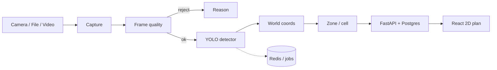

# Warehouse Digital Twin (ЦДС-2026)

**Ivan Iliukhin** — Applied AI / Computer Vision / Python

Solo R&D: an industrial warehouse **digital twin** that turns a top-down camera frame into storage-cell occupancy. Camera → frame quality → YOLO detection → world coordinates → storage cells; FastAPI backend; React 2D plan; Docker; synthetic **virtual stand**. Not employer work; not a production warehouse deployment.

> Metrics below are from the **virtual (synthetic) stand only**. Real camera / hardware validation is not claimed.

## Pitch

Given a monochrome industrial camera view of a warehouse (or a 1:10 tabletop maquette), the system detects boxes, pallets, and containers, maps them into warehouse meters, assigns each object to a rack cell or floor slot, and visualizes the result on a 2D plan. The hard problem is not only detection: objects on raised shelves are offset by **height parallax**, so a single floor homography systematically mis-assigns cells.

## Features

- End-to-end CV pipeline: quality gate → YOLO → geo-mapping → cell lookup (`cv/pipeline.py`)
- **Surface-aware camera model** (K + pose, ray–plane intersection at shelf height) vs floor-only homography
- Synthetic virtual stand matching IMX183 + 12 mm optics (20 MP frames, lighting, defocus, clutter, person in frame)
- FastAPI + PostgreSQL + Redis (Docker Compose: `db`, `redis`, `api`, `worker`, `web`)
- React 2D warehouse plan (react-konva), JWT roles (admin / operator / viewer)
- Camera sources: file, video, Basler (`pypylon`); Hikrobot stub (needs hardware + MVS SDK)
- Equipment notes: [Basler acA5472-17um](docs/equipment/basler-aca5472-17um-report/index.html), [Hikrobot MV-CE200-10UM](docs/equipment/hikrobot-mv-ce200-10um-report/index.html)

## Architecture



Pipeline detail: quality assessment → detection (mono→3ch, scale, tiling, NMS) → person-overlap check → mapper (`FloorHomographyMapper` or `SurfaceAwareMapper`) → `Locator` for zone/cell.

## Stack

| Layer | Choices |
|---|---|
| CV | OpenCV, Ultralytics YOLO11, optional SAHI tiling |
| Backend | Python 3.11, FastAPI, SQLAlchemy 2, Alembic, JWT |
| Data | PostgreSQL 16, Redis 7 |
| Frontend | React 19, antd, react-konva |
| Tooling | uv, Docker Compose, GitHub Actions CI, ruff, pytest |

## Results (virtual stand only)

Source: [docs/05_Виртуальный_стенд.md](docs/05_Виртуальный_стенд.md) — separate test session, **40 frames** at full 20 MP resolution; camera pose / focal error / layout / lighting differ from training.

| Metric | Result | Spec target |
|---|---|---|
| mAP@0.5 (test) | 0.995 | ≥ 0.85 |
| Precision / Recall (`box`) | 1.00 / 1.00 | ≥ 0.90 / 0.90 |
| Cell assignment — **floor homography** | **82.7%**, RMSE 3.7 cm | ≥ 90% — **not met** |
| Cell assignment — **camera model + shelf heights** | **100%**, RMSE 0.55 cm | ≥ 90% |
| Frame time (quality + detect + locate, GPU) | 130 ms avg, 266 ms max | ≤ 3 s |

Synthetic mAP is an **upper bound**: the detector only saw rendered objects. Real accuracy will be lower until a camera-captured dataset is collected.

## Limitations

- No claimed production warehouse or validated hardware campaign; Basler grab script exists but camera check is still pending on the roadmap
- Simulation: simplified textures/lighting; no film glare, crumpled boxes, or rolling-shutter realism; one object per cell; lower rack levels not modeled (not visible from above)
- Scan matching, occupancy snapshots, and full scan API/worker path are next iterations (not finished)
- Hikrobot path needs a real camera and vendor MVS SDK

## What I would do next

1. Capture and label **300–500 real frames** from the maquette camera; fine-tune `sklad-sim-v1` (synthetic as pretrain only)
2. Retune quality thresholds on real grabs (`scripts/grab_one.py`); persist camera pose (`rvec`/`tvec`) and per-cell `surface_z` in the DB
3. Finish scan jobs (RQ worker): matching across scans, occupancy with “unknown” for occluded lower levels, UI for scan results

## Quick start

```bash
cp .env.example .env            # Windows: Copy-Item .env.example .env
docker compose up -d --build
docker compose exec api python /srv/scripts/seed_demo.py   # optional demo layout
```

- UI: http://localhost:8080 — login `admin` / `admin12345` (change in `.env`)
- API / Swagger: http://localhost:8000/api/docs

### Local development

Requires: Python 3.11, [uv](https://docs.astral.sh/uv/), Node.js 24, Docker.

```bash
uv sync                               # .venv: backend + CV (no torch)
docker compose up -d db redis
cd backend
uv run alembic upgrade head
uv run python -m app.bootstrap
uv run uvicorn app.main:app --reload  # :8000
cd ..
uv run python scripts/seed_demo.py

cd frontend && npm install && npm run dev   # :5173, /api → :8000
```

| Extra | Installs |
|---|---|
| `uv sync --extra ml` | Ultralytics YOLO + SAHI (pulls PyTorch) |
| `uv sync --extra basler` | `pypylon`; grab: `uv run python scripts/grab_one.py` |
| `uv sync --extra barcode` | `zxing-cpp` |

Hikrobot MVS SDK is installed from the vendor site; add `MvImport` to `PYTHONPATH`.

### Checks

```bash
uv run pytest --cov
uv run ruff check .
cd backend && uv run alembic check
cd frontend && npm run lint && npm run build
```

### Virtual stand (optional)

```bash
uv sync --extra ml
uv run python -m cv.sim.dataset --train 500 --val 100
uv run python -m cv.training.train --data datasets/synthetic/maquette_v1/data.yaml --name sklad-sim-v1 --epochs 50
uv run python -m cv.sim.evaluate --weights models_store/sklad-sim-v1.pt --scenes 40
```

## Repository layout

```
backend/app/   FastAPI, models, geo/layout services
cv/            sources, quality, camera_model, detector, pipeline, sim/, training/
frontend/src/  React UI, 2D plan, virtual-stand page
scripts/       seed_demo, grab_one, backup
docs/          Russian ТЗ and stand reports; English interview guide
```

Coordinates are warehouse meters; origin at the lower-left of the plan. Code and API identifiers are English; Russian remains in the UI strings and original specification docs.

## Docs (Russian ТЗ and project notes)

- [Technical specification (rev. 2.0)](docs/01_ТЗ_Цифровой_двойник_склада.md)
- [Implementation plan](docs/02_План_реализации.md)
- [Specification review](docs/03_Рецензия_на_ТЗ.md)
- [Development roadmap](docs/04_Дорожная_карта_разработки.md)
- [Virtual stand & trial results](docs/05_Виртуальный_стенд.md)
- [Work log](docs/06_Журнал_работ.md)
- [Interview Q&A (English)](docs/INTERVIEW.md)
