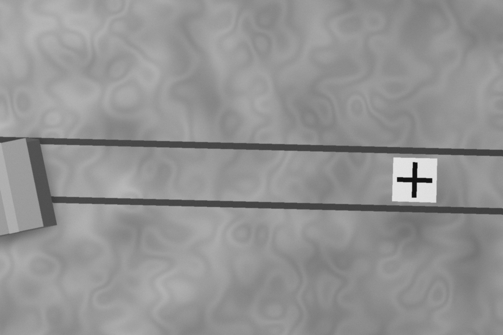
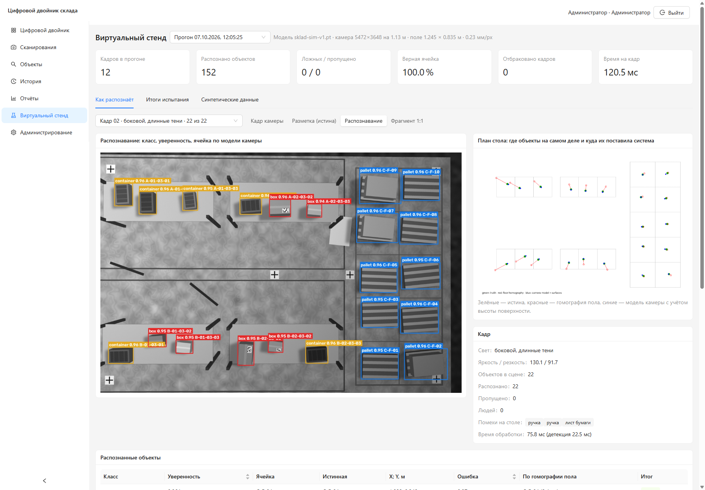
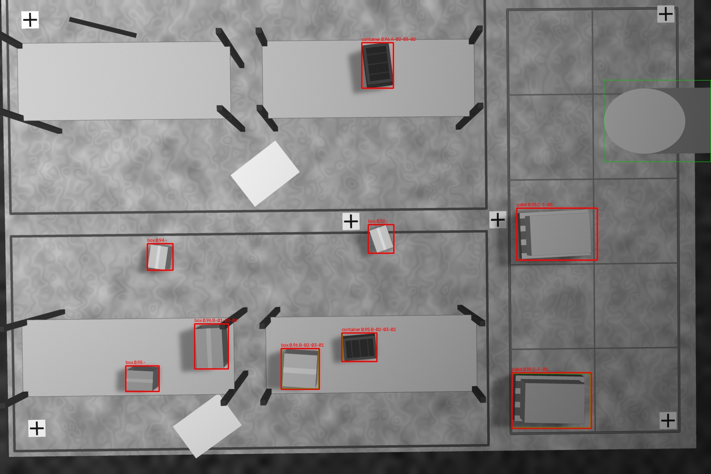
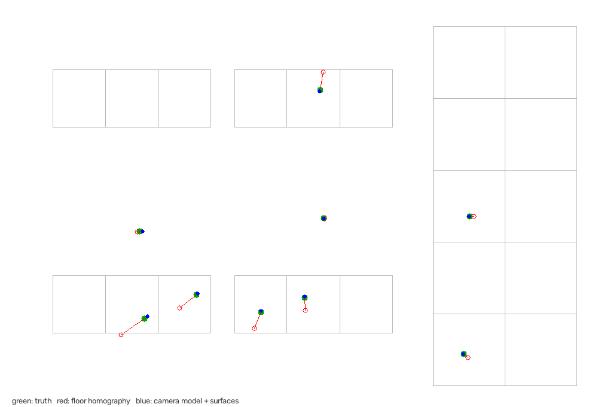

# Виртуальный стенд: распознавание «как видит камера»

Цель — до сборки физического макета проверить конвейер распознавания целиком (кадр → качество →
детекция → координаты → ячейка) на кадрах, геометрически эквивалентных снимкам имеющейся камеры,
и выявить проблемы оптики, калибровки и геопривязки заранее.

## 1. Что моделируется

| Параметр | Значение | Источник |
|---|---|---|
| Сенсор | 5472 × 3648, пиксель 2,4 мкм, монохром | ТЗ 4.4.1 (IMX183) |
| Объектив | 12 мм, дисторсия 0 % | Computar V1226-MPZ |
| Установка | над центром стола, 1,15 м ± 3 см, наклон ±1°, поворот ±2° | ошибки монтажа |
| Фокусное расстояние | номинал ± 0,7 % (неизвестно системе) | допуск объектива |
| Стенд | стол 1,2 × 0,8 м, зоны A/B (хранение), C (погрузка), 4 стеллажа 3 яруса × 3 места, 10 напольных ячеек | `cv/sim/stands/maquette_a.json` |
| Объекты (1:10) | коробки 4–6 см (часть с QR-этикеткой), контейнеры, паллеты (пустые и с грузом) | ТЗ 3.2 |
| Помехи | рука человека в кадре, листы бумаги, ручки, рулоны скотча | ФТ-СКН-07, ложные срабатывания |
| Свет | 4 режима: равномерный, тусклый, боковой с длинными тенями, яркий; виньетирование | ТЗ 4.4.1 |
| Сенсор/оптика | расфокус σ 0,4–1,6 px, шум σ 1,5–4 уровня, 8 бит | — |

Объекты рисуются как параллелепипеды через модель камеры-обскуры, поэтому кадр воспроизводит
главную геометрическую особенность вида сверху — **параллакс по высоте**: верх предмета смещён
от центра кадра тем сильнее, чем он выше и дальше от оси.



## 2. Как запустить

```bash
uv sync --extra ml                                              # PyTorch (CUDA) + Ultralytics
uv run python -m cv.sim.dataset --train 500 --val 100           # синтетический датасет, ~2 мин
uv run python -m cv.training.train --data datasets/synthetic/maquette_v1/data.yaml --name sklad-sim-v1 --epochs 50
uv run python -m cv.sim.evaluate --weights models_store/sklad-sim-v1.pt --scenes 40
```

Отчёт и картинки — в `storage/stand_eval/<дата>/`.

Для веб-интерфейса (раздел «Виртуальный стенд»):

```bash
uv run python -m cv.sim.demo --scenes 12 --clean   # кадры, детекции, планы, образцы датасета -> storage/stand_demo/
docker compose up -d --build                        # http://localhost:8080/stand
```

Страница показывает для каждого кадра: что видит камера, истинную разметку, распознавание,
фрагмент 1:1, план стола с ошибками привязки и таблицу объектов; итоги испытания и образцы
синтетического датасета.



## 3. Модель

YOLO11s (предобучение COCO), вход 1376 px, кадр уменьшается в 4 раза (1368 × 912, коробка 4 см
≈ 43 px), аугментации без цвета (монохром), с отражениями и поворотами (вид сверху). 500 кадров
обучения / 100 валидации, 50 эпох, RTX 3080 — ~15 мин.

## 4. Результаты испытания (отдельная тестовая сессия, 40 кадров 20 Мп)

Тестовая сессия имеет свою установку камеры и свою ошибку фокусного расстояния, расстановки и
свет не совпадают с обучением.

| Показатель | Результат | Требование ТЗ |
|---|---|---|
| mAP@0.5 (тест) | 0,995 | ≥ 0,85 (НФТ-К-01) |
| Precision / Recall `box` | 1,00 / 1,00 | ≥ 0,90 / 0,90 (НФТ-К-02) |
| Ошибка подсчёта (MAE) | 0 | ≤ 1 на 20 (НФТ-К-03) |
| Калибровка: RMSE на контрольных точках пола | 0,05 см | ≤ 1 см (НФТ-К-05) |
| **Привязка к ячейке — гомография пола (как в ТЗ)** | **82,7 %**, RMSE 3,7 см, 95 % ≤ 7,6 см | ≥ 90 % (НФТ-К-04) — **не выполнено** |
| **Привязка к ячейке — модель камеры + высоты полок** | **100 %**, RMSE 0,55 см | ≥ 90 % |
| Время обработки кадра (качество + детекция + привязка) | 130 мс средн., 266 мс макс. (GPU) | ≤ 3 с с GPU (НФТ-П-01) |
| Плохие кадры (тёмный, пересвет, расфокус) | все отбракованы с причиной; нормальные кадры при любом свете приняты | Т-17 |
| Кадры с человеком | 8, все приняты (рука занимает < 20 % кадра), человек найден на всех | Т-19 |

Первый прогон отбраковывал как «размытые» все кадры при тусклом свете (10 из 40): дисперсия
лапласиана пропорциональна квадрату контраста, и резкий тёмный кадр давал 57 при пороге 100.
Контроль качества переведён на нормированную резкость `var(Laplacian) / var(image) × 1000`,
порог 20. На стенде: нормальные кадры 46–174 при любом свете и расфокусе σ ≤ 1,6 px,
расфокусированные (σ ≥ 3 px) — не более 7,6, запас ≈ 2,5 раза в обе стороны.



Красные рамки — детекции (класс, уверенность, ячейка), зелёные — разметка. Листы бумаги
(похожи на коробку сверху) не детектируются.



Зелёные точки — истинное положение, красные — гомография пола, синие — модель камеры с учётом
высоты поверхности. Объекты на полках по гомографии «уезжают» от центра кадра на 3–7 см и
попадают в соседнюю ячейку или за стеллаж.

## 5. Выводы

1. **Плоская гомография пола (ФТ-ЛОК-02 в текущей редакции) не обеспечивает НФТ-К-04 на макете.**
   Верхний ярус стеллажа находится на высоте 13 см при камере на 1,15 м; точка в 40 см от оси
   смещается на 0,4 × 0,13 / (1,15 − 0,13) ≈ 5 см, а ячейка — 11 × 12 см. На складе (вариант Б)
   эффект ещё сильнее: верх стеллажа 2 м при камере на 5 м смещается на 2 / (5 − 2) ≈ 67 % от
   расстояния до оси.
   **Решение:** хранить в калибровке полную модель камеры (матрица K + поза R, t по `solvePnP` из
   тех же ≥ 4 меток, что и для гомографии) и пересекать луч с плоскостью поверхности, на которой
   стоит объект (пол или верхний ярус стеллажа + номинальная высота класса). Реализовано в
   `cv/pipeline.py::SurfaceAwareMapper`. Для расчёта достаточно номинальной K по паспорту
   объектива: ошибка фокусного ±0,7 % компенсируется позой, итоговая ошибка < 1 см.
2. **Высота камеры 1,0 м мала для стола 1,2 × 0,8 м**: поле зрения 1,09 × 0,73 м. При 1,15 м запас
   по короткой стороне ~2 см, и уже наклон 1° выводит край стола из кадра; на высоте верхнего яруса
   поле зрения ещё меньше (1,11 × 0,74 м). Рекомендация: **камера на 1,2 м** (поле 1,31 × 0,88 м,
   0,24 мм/px), стеллажи не ближе 8 см к краю стола, метки калибровки — в 4 см от края.
3. **Детекция на синтетике не ограничивает систему**, но это верхняя оценка: модель видела только
   отрисованные объекты. Реальная точность будет ниже — нужна съёмка датасета с камеры (план, итерация 1).
   Синтетическая модель годится как предобучение и как рабочий детектор для отладки конвейера,
   интерфейса и сопоставления до появления реальных данных.
4. **Абсолютный порог дисперсии лапласиана из ТЗ не годится**: он зависит от освещения и бракует
   резкие тёмные кадры. Используется нормированная резкость (см. раздел 4); ФТ-СКН-06 и настройку
   порога нужно сформулировать через неё. Порог 20 проверить на первых реальных кадрах
   (`scripts/grab_one.py` печатает обе величины).
5. **Рука в кадре** закрывает часть ячеек, но такие кадры принимаются (порог 20 % кадра).
   При сопоставлении (итерация 4) объекты в ячейках под рамкой `person` нельзя считать
   пропавшими — иначе ложные `disappeared`.
6. Производительность с запасом в 20 раз: конвейер можно запускать на полном кадре без биннинга.

## 6. Ограничения симуляции

- Текстуры и освещение упрощены; нет бликов, отражений плёнки, мятых коробок, реального шума
  rolling shutter.
- Объекты не перекрывают друг друга (по одному в ячейке); нижние ярусы не моделируются (их не
  видно сверху, ФТ-ЛОК-06).
- Метки калибровки «кликаются» с ошибкой σ = 1,5 px; на реальном кадре точность клика зависит от UI.

## 7. Что изменить в проекте

| Где | Изменение |
|---|---|
| ТЗ ФТ-ЛОК-02, ФТ-КАМ-05 | Геопривязка через модель камеры (K + поза) с учётом высоты поверхности; гомография — частный случай для объектов на полу |
| БД `camera_calibrations` | Добавить `rvec`, `tvec` (поза); `camera_matrix` заполнять номиналом, если нет калибровки по шахматке |
| БД `shelves` / `cells` | Высота поверхности ячейки (`surface_z`) — вычисляется из высоты стеллажа и яруса |
| Паспорт стенда | Камера на 1,2 м, отступы стеллажей от края |
| Итерация 4 | Не помечать исчезнувшими объекты под человеком |
| ТЗ ФТ-СКН-06 | Резкость — нормированная (`var(Laplacian)/var(image)`), а не абсолютная дисперсия |
